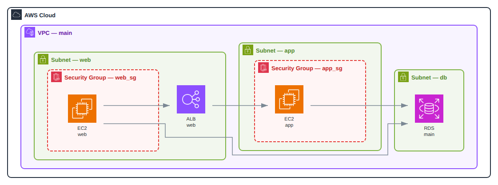
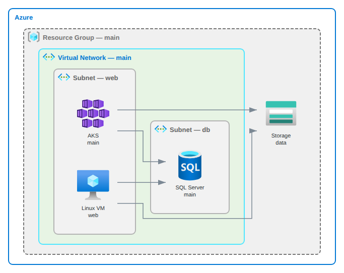
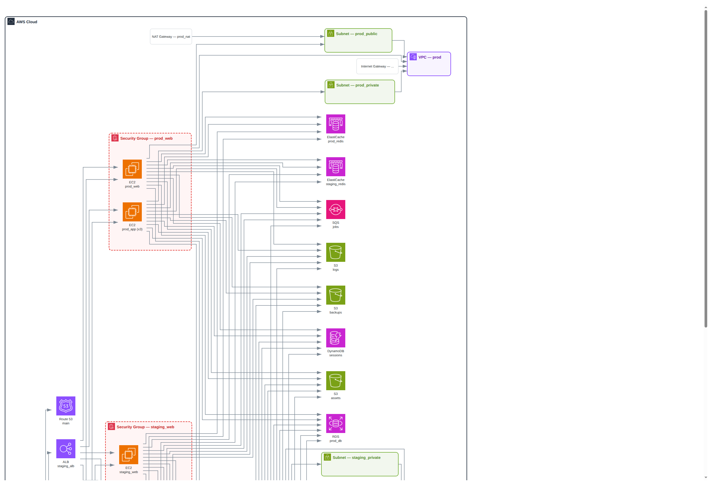
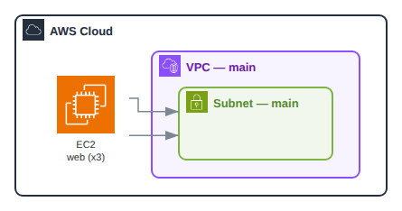
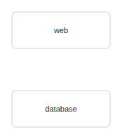
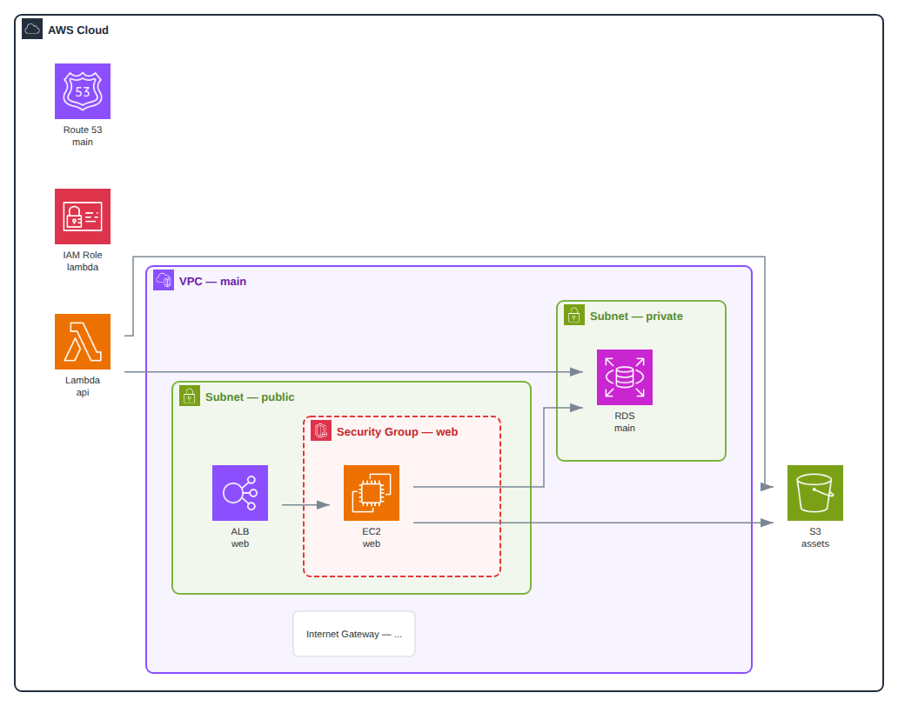
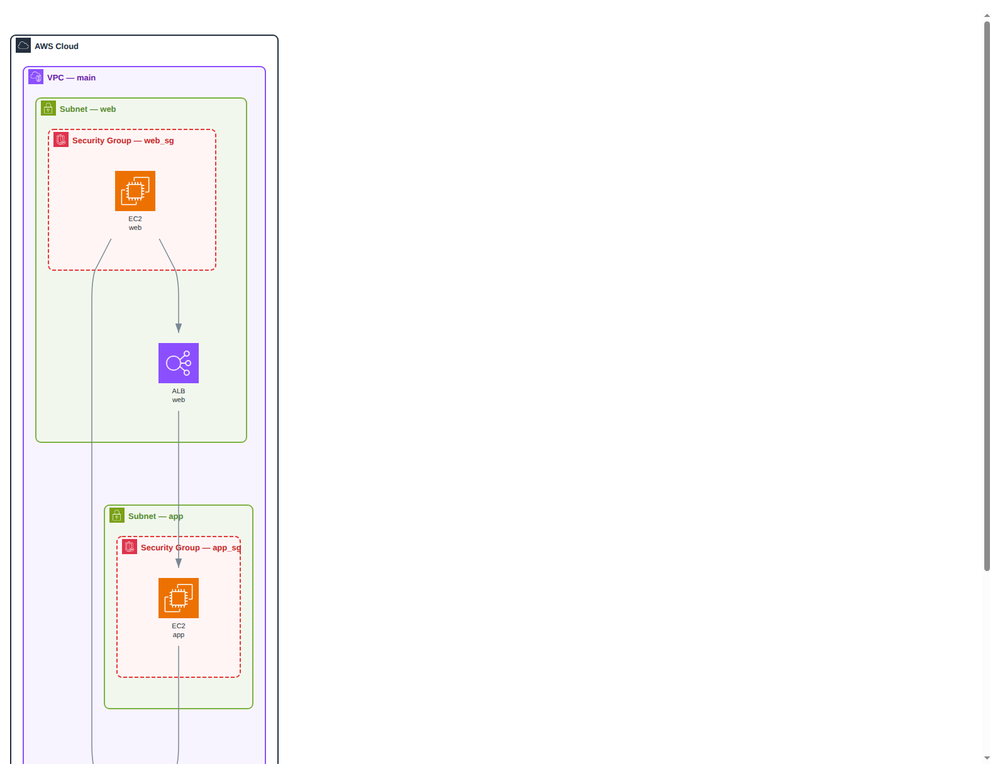

# Stackgraph at Scale — 2026-08 Product Review

Review of the proof-of-concept on branch `fable/module-move-and-improvements`,
after the module move to `github.com/vhco-pro/stackgraph`. The resulting plan
lives in [v2-improvement-spec.md](../v2-improvement-spec.md).

**Verdict: the concept is right, the moat is real, and the pipeline has one
fatal flaw class that makes real states render as garbage.** Every failure
traces to containment being inferred from graph edges (which usually don't
exist yet when grouping runs) and to edges being invented from type-pair
patterns rather than evidence. Both are fixable with a pipeline reorder and a
declarative `parent_ref` mapping — the good bones (single graph IR,
`tofu show -json` contract, self-contained SVG, embedded layout engine) are
worth keeping.

## What it does well

On the bundled single-VPC fixtures, the ELK renderer produces genuinely
attractive, correctly nested diagrams — official icons, brand-styled
containers, dark mode, all in a dependency-free binary. This quality bar is
real and worth protecting with golden tests.

| Works | Works |
|---|---|
|  |  |
| **AWS three-tier fixture.** Correct VPC → subnet → security group nesting, clean orthogonal edges. | **Azure multi-service fixture.** Resource Group → VNet → Subnet hierarchy with brand styling. |

## Where it breaks

A synthetic but realistic 39-resource state — two VPCs (`prod` + `staging`),
no `depends_on`, the shape many real states have — collapses completely: the
VPC is an *empty box*, both subnets are empty boxes *outside* it, and 74 edges
(most fabricated) bundle into spaghetti across the canvas, including invented
prod → staging flows.

**The smoking gun.** Containment fails silently without `depends_on` edges;
`inferFlowEdges` adds cartesian-product edges (every instance → every bucket);
NAT and Internet Gateway render as truncated grey text boxes.

| Bug | Bug |
|---|---|
|  |  |
| **Count-collapse loses containment.** The collapsed `EC2 web (x3)` lands outside the VPC, pointing at an empty subnet — on a *shipped fixture*. | **Unmapped providers degrade too far.** Proxmox renders as two bare boxes — no boundary, no edge between web and database. |

| Weak | Weak |
|---|---|
|  |  |
| **Global services scatter.** Route 53 is fully disconnected; IAM/Lambda strand along the left; the Internet Gateway label truncates to "— ...". | **Dagre — the current default engine.** Same state as the good three-tier render: one tall column, huge gaps, edges through containers. Strictly worse than ELK, yet it's the default. |

## Root causes

Severity-ranked; all verified against the tree. File/line details and the
fixes are in [v2-improvement-spec.md](../v2-improvement-spec.md).

1. **Critical — grouping runs before edge detection, and uses edges as its
   containment signal.** `generate.go:83-87` runs `ApplyGrouping()` before
   `DetectImplicitEdges()`, so nesting only works when `depends_on` happens to
   be present — and even then can't disambiguate two VPCs.
2. **Critical — `inferFlowEdges` invents cartesian-product edges.** 40
   type-pairs joined N×M with no attribute evidence: 30 instances + 30 DBs =
   900 fake edges.
3. **Critical — nested-module addresses are duplicated.** `state.go:52-55`
   re-prefixes already-qualified addresses
   (`module.net.module.net.aws_subnet.a`), breaking plan actions, `depends_on`
   resolution, and collapse for every module resource.
4. **Critical — count-collapse drops parent/child links.**
   `CollapseCountInstances` rewrites IDs and edges but not `Parent`/`Children`;
   renderers classify containers by `len(Children)`, so nodes fall out of
   clusters and empty containers render.
5. **Major — plan mode is largely non-functional.** Replace actions fall
   through unmatched; destroyed resources never appear; action colors only
   apply to icon-less nodes. `testdata/plan/` and `testdata/terragrunt/` are
   empty directories, and the terragrunt parser can panic on a non-string
   `config_path`.
6. **Major — the YAML mapping layer is decorative.** Renderers hardcode a
   51-type icon switch and three style maps; 62 of 91 YAML `icon:` paths point
   at files that don't exist (and ship broken to the frontend JSON).
7. **Minor — robustness debt.** goja VMs with no timeout/interrupt (~140MB RSS
   per ELK render), byte-sliced UTF-8 label truncation, no cycle guards on
   parent walks, duplicate arrows from type-keyed edge dedup, ~70% duplicated
   code between the two SVG renderers, 28MB binary (1748 embedded icons, ~51
   used).

## The path to best-in-scene

Competitors are weak — Terravision needs credentials and Graphviz, InfraMap
imports terraform internals and draws flat graphs. Nobody owns "point it at
`tofu show -json`, get a correct diagram." The implementation order is in
[v2-improvement-spec.md](../v2-improvement-spec.md): Release 1 "make it
honest" (containment redesign, evidence-based edges, mapping-driven rendering,
ELK-only, invariant tests), Release 2 "make it win" (plan-diff rendering,
coverage tooling, interactive HTML output).
